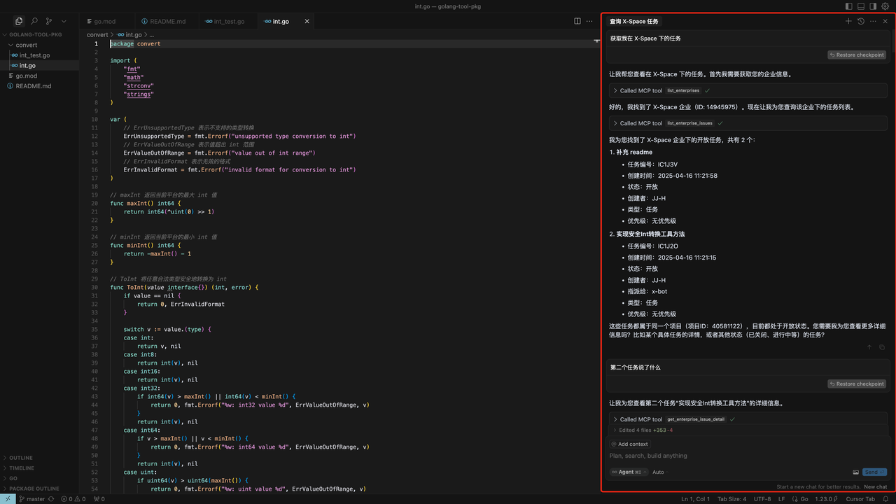
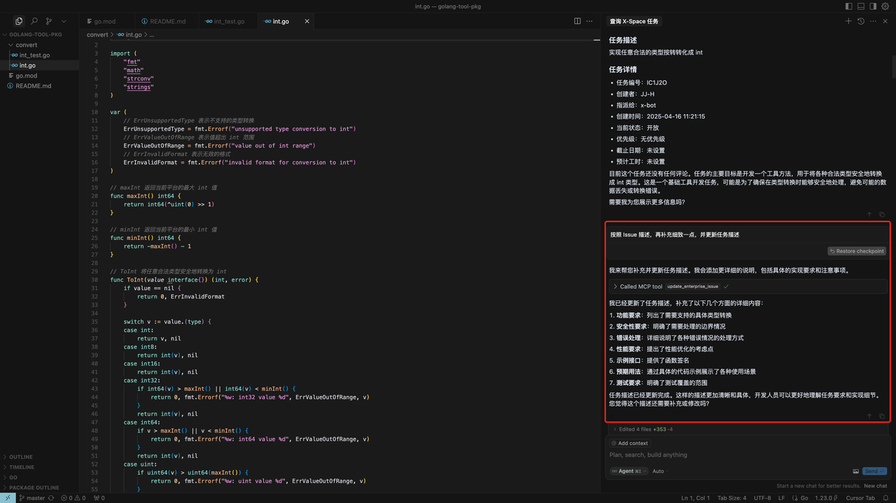
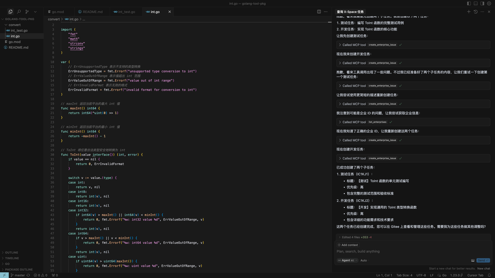
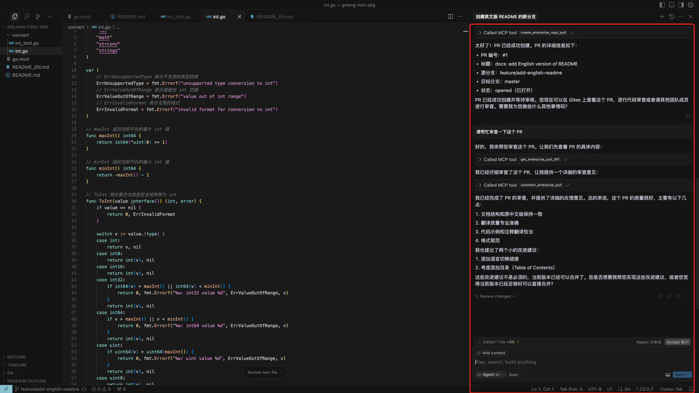

# Gitee Enterprise MCP Server

Gitee Enterprise MCP Server is a Model Context Protocol (MCP) server implementation for Gitee Enterprise. It provides a set of tools for interacting with Gitee Enterprise API, allowing AI assistants to manage enterprise repositories, issues, pull requests, and more.

[](https://cursor.com/en/install-mcp?name=gitee-ent&config=eyJjb21tYW5kIjoibnB4IC15IEBnaXRlZS9tY3AtZ2l0ZWUtZW50QGxhdGVzdCIsImVudiI6eyJHSVRFRV9FTlRfTUNQX0FDQ0VTU19UT0tFTiI6Ijx5b3VyIG1jcCBlbnQgYWNjZXNzIHRva2VuPiJ9fQ%3D%3D)

## Features

- Interact with Gitee Enterprise repositories, issues, pull requests, and knowledge-base documents
- Support for enterprise-level operations and management
- Configurable API base URL to support different Gitee Enterprise instances
- Support for SSE and Stdio transport
- Dynamic toolset enable/disable

<Details>
<summary><b>Scenario Example</b></summary>

1. Get specific enterprise issues
   
2. Improve the issue content
   
3. Divide subtasks
   
4. Create PR/Review PR
   
</details>

## Installation(This step can be skipped directly when starting npx)

### Prerequisites

- Go 1.23.0 or higher
- MCP token, [Go to get](https://gitee.com/profile/mcp_gitee_ent_access_tokens)

### Building from Source

1. Clone the repository:
   ```bash
   git clone https://gitee.com/oschina/mcp-gitee-ent.git
   cd mcp-gitee-ent
   ```

2. Build the project:
   ```bash
   make build
   ```
   Move ./bin/mcp-gitee-ent PATH env

### Use go install
   ```bash
   go install gitee.com/oschina/mcp-gitee-ent@latest
   ```

## Usage

Check mcp-gitee-ent version:

```bash
mcp-gitee-ent --version
```

## MCP Hosts Configuration
<div align="center">
  <a href="docs/install/claude.md" title="Claude"></a>
  <a href="docs/install/cursor.md" title="Cursor"></a>
  <a href="docs/install/trae.md" title="Trae"></a>
  <a href="docs/install/cline.md" title="Cline"></a>
  <a href="docs/install/windsurf.md" title="Windsurf"></a>
</div>

Config example:
- npx
```json
{
  "mcpServers": {
    "gitee-ent": {
      "command": "npx",
      "args": [
        "-y",
        "@gitee/mcp-gitee-ent@latest"
      ],
      "env": {
         "GITEE_ENT_API_BASE": "https://api.gitee.com/enterprises",
         "GITEE_ENT_MCP_ACCESS_TOKEN": "<your mcp ent access token>",
         "GITEE_ENT_MCP_ALLOWED_FILE_ROOTS": "/absolute/path/to/allowed/files"
      }
    }
  }
}
```
- executable
```json
{
  "mcpServers": {
    "gitee-ent": {
      "command": "mcp-gitee-ent",
      "env": {
        "GITEE_ENT_API_BASE": "https://api.gitee.com/enterprises",
        "GITEE_ENT_MCP_ACCESS_TOKEN": "<your mcp ent access token>",
        "GITEE_ENT_MCP_ALLOWED_FILE_ROOTS": "/absolute/path/to/allowed/files"
      }
    }
  }
}
```

### Command-line Options

- `--token`: access token
- `--api-base`: Gitee Ent API base URL (default: https://api.gitee.com/enterprises)
- `--version`: Show version information
- `--transport`: Transport type (stdio or sse, default: stdio)
- `--sse-address`: The host and port to start the SSE server on (default: localhost:8000)
- `--enabled-toolsets`: Comma-separated list of tools to enable (if specified, only these tools will be enabled)
- `--disabled-toolsets`: Comma-separated list of tools to disable

### Environment Variables

You can also configure the server using environment variables:

- `GITEE_ENT_MCP_ACCESS_TOKEN`: Gitee MCP ent access token
- `GITEE_ENT_API_BASE`: Gitee ENT API base URL
- `GITEE_ENT_MCP_ALLOWED_FILE_ROOTS`: Allowed absolute directories for document upload and download. Separate multiple directories with the operating system path-list separator (`:` on Unix, `;` on Windows). Defaults to the server's current working directory.
- `ENABLED_TOOLSETS`: Comma-separated list of tools to enable
- `DISABLED_TOOLSETS`: Comma-separated list of tools to disable

#### Document File Access Scope

| Configuration | Effective scope |
|---------------|-----------------|
| Not set | The MCP server process's current working directory and its descendants |
| `/` on Unix/macOS | Any existing path that the MCP server process can access |
| `C:\;D:\` on Windows | Any accessible path on the listed drives |
| `/srv/gitee-imports:/srv/gitee-exports` on Unix/macOS | Only the listed directories and their descendants |

Configured roots must be existing absolute directories. Symbolic links are resolved before the scope check, and operating-system permissions, container mounts, and sandbox restrictions still apply. Setting a filesystem root grants the document tools broad local read/write access, so use it only for a trusted local MCP server; use dedicated import and export directories for shared or remote deployments.

### Toolset Management

Toolset management supports two modes:

1. Enable specified tools (whitelist mode):
   - Use `--enabled-toolsets` parameter or `ENABLED_TOOLSETS` environment variable
   - Specify after, only listed tools will be enabled, others will be disabled
   - Example: `--enabled-toolsets="update_enterprise_issue,list_enterprise_repositories"`

2. Disable specified tools (blacklist mode):
   - Use `--disabled-toolsets` parameter or `DISABLED_TOOLSETS` environment variable
   - Specify after, listed tools will be disabled, others will be enabled
   - Example: `--disabled-toolsets="update_enterprise_issue,list_enterprise_repositories"`

Note:
- If both `enabled-toolsets` and `disabled-toolsets` are specified, `enabled-toolsets` takes precedence
- Tool names are case-sensitive
- An explicit entry in `enabled-toolsets` wins over the same entry in `disabled-toolsets`

## Progressive Tool Discovery

The server exposes three discovery meta-tools so that a client can work with the full catalog without listing every tool up front:

1. `search_tools(query, domain?, limit?)` finds candidate tool names by natural-language query. Results include the tool name, summary, domain, risk, and required argument names. `domain` narrows the search to one catalog domain, and `limit` defaults to 8 (maximum 20).
2. `inspect_tool(name)` returns the full input schema, notes, and a valid example for one exact tool name. Inspect a search result before invoking it when argument names or formats are unclear.
3. `invoke_tool(name, arguments)` executes one exact tool name with a JSON argument object. It cannot call itself recursively.

Tool discovery is filtered by the same toolset configuration as direct tool registration. A tool that is disabled or hidden by `ENABLED_TOOLSETS` / `DISABLED_TOOLSETS` is rejected by both `inspect_tool` and `invoke_tool`, and it is not returned by `search_tools`. When a request carries its own tool filter, `inspect_tool` and `invoke_tool` reject tools outside that filter as well, and unknown-name suggestions only include tools available to the request.

Search never fabricates results. If a query only matches ineligible tools (for example, a disabled domain), it still returns the regular no-match message and suggests broadening the keywords or removing the domain filter.

The discovery meta-tools are infrastructure: `search_tools`, `inspect_tool`, and `invoke_tool` remain available when an `ENABLED_TOOLSETS` allowlist is set, even if they are not explicitly listed. They are hidden only when explicitly named in `DISABLED_TOOLSETS`, unless they are also explicitly named in `ENABLED_TOOLSETS`, in which case the enabled entry wins.

### Canonical Parameter Names

Tool arguments use unambiguous names; renamed legacy arguments are rejected with a migration hint.

| Canonical | Replaces / meaning |
|---|---|
| `repository_id` | `project_id`; accepts a repository ID or repository path |
| `repository_ids` | `project_ids`; repository IDs for filters or associations |
| `program_id` | Gitee Program (项目) ID, not a repository |
| `program_ids` | Multiple Gitee Program (项目) IDs |
| `passed` | Boolean test-report state previously named `state` |
| `state_id` | Numeric state previously named `state` |
| `statuses` | Comma-separated program status filters previously named `status` |
| `priorities` | Comma-separated priority filters previously named `priority` |
| `assignee_ids` | Comma-separated assignee filters previously named `assignee_id` |
| `linked_issue_id` | Numeric issue filter previously named `issue_id` |
| `test_plan_ids` | Array of numeric test-plan IDs when listing reports |

`pull_request_iid` is the repository-scoped display IID; `pull_request_id` is the internal database ID.

## Available Tools

The server provides various tools for interacting with Gitee Enterprise:

| Tool                                    | Category      | Description |
|----------------------------------------|---------------|-------------|
| **list_enterprises**     | Enterprise    | List user's enterprises |
| **list_enterprise_repositories** | Repository | List repositories in an enterprise |
| **create_enterprise_repository** | Repository | Create a repository in an enterprise |
| **create_enterprise_repo_release** | Repository | Create a release for repository |
| **list_enterprise_repo_releases** | Repository | List releases for repository |
| **get_enterprise_repository_file_content** | Repository | Get the content of a specific file in the repository |
| **get_enterprise_repo_tree** | Repository | Get the tree structure of a repository |
| **list_enterprise_pulls** | Pull Request | List enterprise pull requests |
| **create_enterprise_repo_pull** | Pull Request | Create a pull request for repository |
| **merge_enterprise_pull** | Pull Request | Merge a pull request |
| **get_enterprise_pull_detail** | Pull Request | Get pull request detail |
| **update_enterprise_pull** | Pull Request | Update a pull request |
| **get_enterprise_pull_diff** | Pull Request | Get pull request diff |
| **comment_enterprise_pull** | Pull Request | Comment on a pull request |
| **list_enterprise_pull_comments** | Pull Request | List pull request comments |
| **create_enterprise_issue** | Issue | Create an issue |
| **update_enterprise_issue** | Issue | Update an issue |
| **get_enterprise_issue_detail** | Issue | Get issue detail |
| **list_enterprise_issues** | Issue | List issues |
| **comment_enterprise_issue** | Issue | Comment on an issue |
| **list_enterprise_issue_comments** | Issue | List issue comments |
| **get_user_info**        | User         | Get user info |
| **list_enterprise_members** | Member | List members of an enterprise |
| **list_enterprise_groups** | Group | List groups in an enterprise |
| **list_enterprise_labels** | Label | List labels of an enterprise |
| **list_programs**        | Program      | List programs of an enterprise |
| **list_scrum_sprints**   | Program        | List Scrum Sprints |
| **create_scrum_sprint**  | Program        | Create a Scrum Sprint |
| **list_scrum_versions**  | Program        | List Scrum Versions |
| **list_issue_types**     | Issue Type   | List issue types |
| **list_issue_type_states** | Issue State | List issue states |
| **create_enterprise_document** | Document | Create a new enterprise knowledge-base document |
| **create_enterprise_document_node** | Document | Create a page or folder inside an existing document |
| **rename_enterprise_document_folder** | Document | Rename a folder in an existing document |
| **list_enterprise_documents** | Document | List or search accessible enterprise knowledge-base documents |
| **list_enterprise_document_pages** | Document | List and flatten a document's page tree |
| **get_enterprise_document_page** | Document | Get a document page's source content and metadata |
| **upload_enterprise_document_files** | Document | Import local ZIP, HTML, TXT, or Markdown files into a document |
| **download_enterprise_document** | Document | Export a document as Markdown, HTML, or PDF to a local directory |
| **update_enterprise_document_page** | Document | Replace a page's content with a version precondition |
| **search_tools** | Discovery | Find candidate tool names by natural-language query |
| **inspect_tool** | Discovery | Show the full argument schema and a valid example for one tool |
| **invoke_tool** | Discovery | Execute one enabled tool by exact name with a JSON argument object |

### Enterprise Document Workflow

1. Call `list_enterprises` to resolve the target `enterprise_id`.
2. To start a new document, call `create_enterprise_document` and use the returned `document_id` in the other document tools. Otherwise call `list_enterprise_documents` and use its `document_id`. Use `program_id` for program documents or `created_by_me=true` to limit the result when needed.
   - To find documents by keyword, pass `search`. The server matches document names and page names (and page content when full-text search is enabled) and returns page-level hits, each carrying its `document_id` and `page_id`; the result is ordered by the sort field descending with a server-fixed page size, so `program_id`, `created_by_me`, `direction`, and `per_page` cannot be combined with `search`.
3. Call `list_enterprise_document_pages` to resolve a page's `page_id`, flattened path, content type, and current version. To add structure, call `create_enterprise_document_node` with `type` set to `page` or `folder`, passing an optional `parent_id` to nest it under an existing folder. Rename a folder with `rename_enterprise_document_folder`; rename a page via `update_enterprise_document_page`'s `page_name`.
4. Call `get_enterprise_document_page` immediately before editing. Preserve the returned content representation and pass its version as `expected_version` to `update_enterprise_document_page`.

`document_id` is the underlying `WikiInfo.id`. `document_node_id` identifies the document's location in the enterprise knowledge-base tree and is returned only as metadata. `page_id` identifies a page or folder inside the document.

Document permissions are enforced by Gitee Enterprise. A document returned by `list_enterprise_documents` may still be read-only for the authenticated user.

#### Upload and File Access

- `upload_enterprise_document_files` adds pages to an existing document; it does not create a document. It accepts 1 to 20 absolute paths with `.zip`, `.html`, `.txt`, or `.md` extensions. Each file must be no larger than 6 MiB, and imported content may contain at most 20 pages.
- Upload and download paths refer to the machine running this MCP server, not the Agent user's remote machine. Paths must be absolute, resolve inside `GITEE_ENT_MCP_ALLOWED_FILE_ROOTS`, and already exist. The download destination must be a directory.
- Import processing may finish asynchronously. After an upload, call `list_enterprise_document_pages` or `get_enterprise_document_page` again to obtain the imported page's final version before updating it.

#### Export and Update Safety

- Markdown and HTML exports may be ZIP archives; PDF exports are PDF files. `download_enterprise_document` does not overwrite an existing path unless `overwrite=true` is explicitly supplied.
- `update_enterprise_document_page` performs a complete content replacement, not a patch. An empty `content` value clears the page. The tool re-reads the page and rejects the update when `expected_version` is stale.
- `page_name` optionally renames the page, and `mentioned_user_ids` accepts enterprise user IDs returned by `list_enterprise_members`.

## Release

The repository provides a repeatable local release workflow that validates and builds tagged source, creates or reuses a Gitee Release, synchronizes its release notes, and uploads missing artifacts. See [docs/releasing.md](docs/releasing.md). npm publishing remains a separate resumable step.

## Contribution

We welcome contributions from the open-source community! If you'd like to contribute to this project, please follow these guidelines:

1. Fork the repository.
2. Create a new branch for your feature or bug fix.
3. Make your changes and ensure the code is well-documented.
4. Submit a pull request with a clear description of your changes.

For more information, please refer to the [CONTRIBUTING](CONTRIBUTING.md) file.
