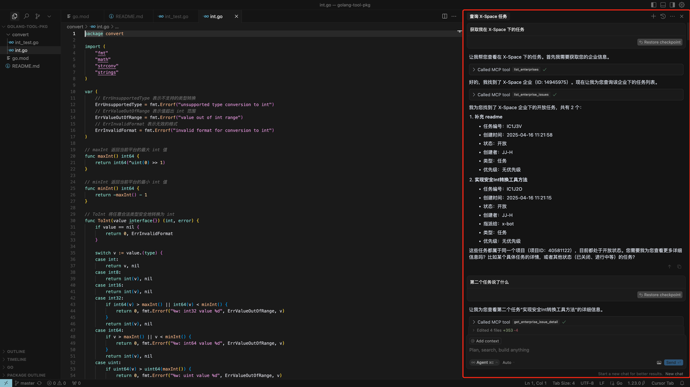
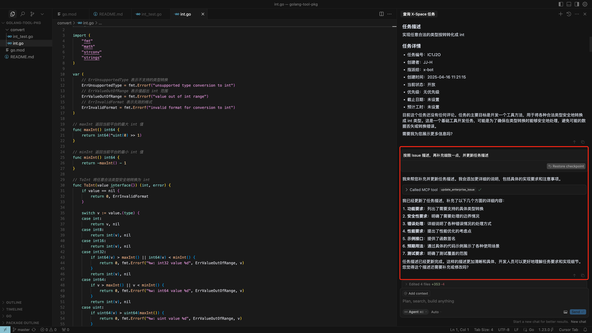
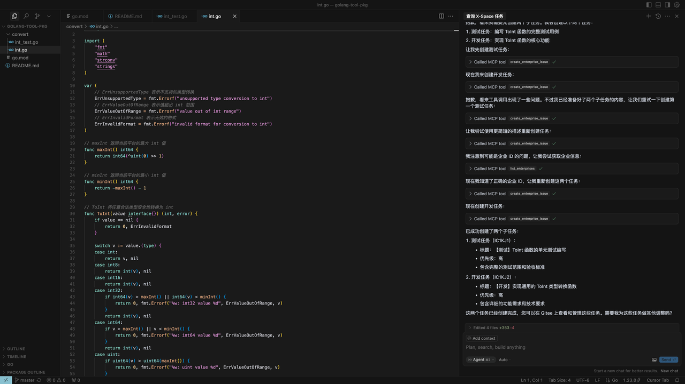
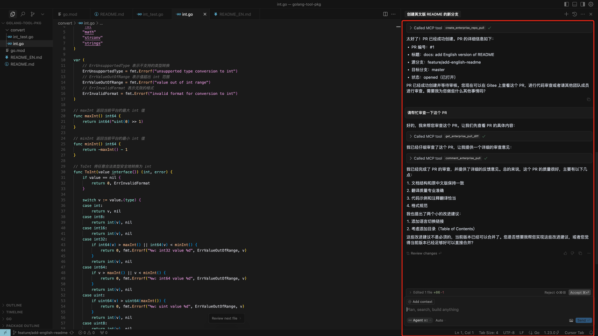

# Gitee 企业版 MCP 服务器

Gitee 企业版 MCP 服务器是一个用于 Gitee 企业版的模型上下文协议（MCP）服务器实现。它提供了一套工具集，用于与 Gitee 企业版 API 交互，使 AI 助手能够管理企业仓库、问题、拉取请求等。

[](https://cursor.com/en/install-mcp?name=gitee-ent&config=eyJjb21tYW5kIjoibnB4IC15IEBnaXRlZS9tY3AtZ2l0ZWUtZW50QGxhdGVzdCIsImVudiI6eyJHSVRFRV9FTlRfTUNQX0FDQ0VTU19UT0tFTiI6Ijx5b3VyIG1jcCBlbnQgYWNjZXNzIHRva2VuPiJ9fQ%3D%3D)

## 功能特性

- 与 Gitee 企业版仓库、问题、拉取请求和知识库文档交互
- 支持企业级操作和管理
- 可配置的 API 基础 URL，支持不同的 Gitee 企业版实例
- 支持 SSE 和 Stdio 两种传输方式
- 支持动态启用/禁用工具集

<Details>
<summary><b>场景示例</b></summary>

1. 获取特定企业的问题
   
2. 改进问题内容
   
3. 划分子任务
   
4. 创建 PR/评审 PR
   
</details>

## 安装（npx 启动可直接跳过该步骤）

### 前提条件

- Go 1.23.0 或更高版本
- MCP 令牌，[前往获取](https://gitee.com/profile/mcp_gitee_ent_access_tokens)

### 从源码构建

1. 克隆仓库：
   ```bash
   git clone https://gitee.com/oschina/mcp-gitee-ent.git
   cd mcp-gitee-ent
   ```

2. 构建项目：
   ```bash
   make build
   ```
   将 ./bin/mcp-gitee-ent 移动到 PATH 环境变量中

### 使用 go install
   ```bash
   go install gitee.com/oschina/mcp-gitee-ent@latest
   ```

## 使用方法

检查 mcp-gitee-ent 版本：

```bash
mcp-gitee-ent --version
```

## MCP 主机配置
<div align="center">
  <a href="docs/install/claude.md" title="Claude"></a>
  <a href="docs/install/cursor.md" title="Cursor"></a>
  <a href="docs/install/trae.md" title="Trae"></a>
  <a href="docs/install/cline.md" title="Cline"></a>
  <a href="docs/install/windsurf.md" title="Windsurf"></a>
</div>

配置示例：
- npx 启动
```json
{
  "mcpServers": {
    "gitee-ent": {
      "command": "npx",
      "args": [
        "-y",
        "@gitee/mcp-gitee-ent@latest"
      ],
      "env": {
         "GITEE_ENT_API_BASE": "https://api.gitee.com/enterprises",
         "GITEE_ENT_MCP_ACCESS_TOKEN": "<your mcp ent access token>",
         "GITEE_ENT_MCP_ALLOWED_FILE_ROOTS": "/允许访问的绝对路径"
      }
    }
  }
}
```
- 可执行文件启动
```json
{
  "mcpServers": {
    "gitee-ent": {
      "command": "mcp-gitee-ent",
      "env": {
        "GITEE_ENT_API_BASE": "https://api.gitee.com/enterprises",
        "GITEE_ENT_MCP_ACCESS_TOKEN": "<your mcp ent access token>",
        "GITEE_ENT_MCP_ALLOWED_FILE_ROOTS": "/允许访问的绝对路径"
      }
    }
  }
}
```

### 命令行选项

- `--token`: 访问令牌
- `--api-base`: Gitee 企业版 API 基础 URL（默认：https://api.gitee.com/enterprises）
- `--version`: 显示版本信息
- `--transport`: 传输类型（stdio 或 sse，默认：stdio）
- `--sse-address`: SSE 服务器的地址和端口（默认：localhost:8000）
- `--enabled-toolsets`: 逗号分隔的要启用的工具列表（如果指定，则只启用这些工具）
- `--disabled-toolsets`: 逗号分隔的要禁用的工具列表

### 环境变量

你也可以使用环境变量来配置服务器：

- `GITEE_ENT_MCP_ACCESS_TOKEN`: Gitee MCP 企业版访问令牌
- `GITEE_ENT_API_BASE`: Gitee 企业版 API 基础 URL
- `GITEE_ENT_MCP_ALLOWED_FILE_ROOTS`: 文档上传和下载允许访问的绝对目录。多个目录使用操作系统的路径列表分隔符分隔（Unix 为 `:`，Windows 为 `;`）。默认仅允许服务器的当前工作目录。
- `ENABLED_TOOLSETS`: 逗号分隔的要启用的工具列表
- `DISABLED_TOOLSETS`: 逗号分隔的要禁用的工具列表

#### 文档文件访问范围

| 配置 | 实际允许范围 |
|------|-------------|
| 未设置 | MCP 服务器进程的当前工作目录及其子目录 |
| Unix/macOS 上设置为 `/` | MCP 服务器进程有权访问的任意已存在路径 |
| Windows 上设置为 `C:\;D:\` | 所列磁盘中进程有权访问的任意路径 |
| Unix/macOS 上设置为 `/srv/gitee-imports:/srv/gitee-exports` | 仅允许所列目录及其子目录 |

配置项必须是已存在的绝对目录。范围校验前会解析符号链接，操作系统权限、容器挂载和沙箱限制仍然有效。将文件系统根目录加入白名单会赋予文档工具很大的本地读写范围，只应在可信的本机 MCP 服务中使用；共享或远程部署应配置专用的导入、导出目录。

### 工具集管理

工具集管理支持两种模式：

1. 启用指定工具（白名单模式）：
   - 使用 `--enabled-toolsets` 参数或 `ENABLED_TOOLSETS` 环境变量
   - 指定后，只有列出的工具会被启用，其他工具都会被禁用
   - 例如：`--enabled-toolsets="update_enterprise_issue,list_enterprise_repositories"`

2. 禁用指定工具（黑名单模式）：
   - 使用 `--disabled-toolsets` 参数或 `DISABLED_TOOLSETS` 环境变量
   - 指定后，列出的工具会被禁用，其他工具保持启用
   - 例如：`--disabled-toolsets="update_enterprise_issue,list_enterprise_repositories"`

注意：
- 如果同时指定了 `enabled-toolsets` 和 `disabled-toolsets`，则 `enabled-toolsets` 优先
- 工具名称区分大小写

## 可用工具

服务器提供了多种工具用于与 Gitee 企业版交互：

| 工具                                 | 类别           | 描述          |
|------------------------------------|--------------|-------------|
| **list_enterprises**               | 企业           | 列出用户的企业     |
| **list_enterprise_repositories**   | 仓库           | 列出企业中的仓库    |
| **create_enterprise_repository**   | 仓库           | 在企业中创建仓库    |
| **create_enterprise_repo_release** | 仓库           | 为仓库创建发行版    |
| **list_enterprise_repo_releases**  | 仓库           | 列出仓库发行版     |
| **get_enterprise_repository_file_content** | 仓库 | 获取仓库中特定文件的内容 |
| **get_enterprise_repo_tree** | 仓库 | 获取仓库的目录树结构 |
| **list_enterprise_pulls**          | Pull Request | 列出企业拉取请求    |
| **create_enterprise_repo_pull**    | Pull Request | 创建仓库拉取请求    |
| **merge_enterprise_pull**          | Pull Request | 合并拉取请求      |
| **get_enterprise_pull_detail**     | Pull Request | 获取拉取请求详情    |
| **update_enterprise_pull**         | Pull Request | 更新拉取请求      |
| **get_enterprise_pull_diff**       | Pull Request | 获取拉取请求差异    |
| **comment_enterprise_pull**        | Pull Request | 评论拉取请求      |
| **list_enterprise_pull_comments**  | Pull Request | 列出拉取请求评论    |
| **create_enterprise_issue**        | Issue        | 创建 Issue    |
| **update_enterprise_issue**        | Issue        | 更新 Issue    |
| **get_enterprise_issue_detail**    | Issue        | 获取 Issue 详情 |
| **list_enterprise_issues**         | Issue        | 列出 Issues   |
| **comment_enterprise_issue**       | Issue        | 评论 Issue    |
| **list_enterprise_issue_comments** | Issue        | 列出 Issue 评论 |
| **get_user_info**                  | 用户           | 获取用户信息      |
| **list_enterprise_members**        | 成员           | 列出企业成员      |
| **list_enterprise_groups**         | 团队           | 列出企业团队      |
| **list_enterprise_labels**         | 标签           | 列出企业标签      |
| **list_programs**                  | 项目           | 列出企业项目      |
| **list_scrum_sprints**             | 项目           | 列出 Scrum 迭代 |
| **create_scrum_sprint**            | 项目           | 创建 Scrum 迭代 |
| **list_scrum_versions**            | 项目           | 列出 Scrum 版本 |
| **list_issue_types**               | 工作项类型        | 列出工作项类型     |
| **list_issue_type_states**         | 工作项状态        | 列出工作项状态     |
| **create_enterprise_document** | 文档 | 新建企业知识库文档 |
| **create_enterprise_document_page** | 文档 | 在已有文档内新建页面 |
| **create_enterprise_document_folder** | 文档 | 在已有文档内新建文件夹 |
| **rename_enterprise_document_folder** | 文档 | 重命名已有文档内的文件夹 |
| **list_enterprise_documents** | 文档 | 列出或搜索可访问的企业知识库文档 |
| **list_enterprise_document_pages** | 文档 | 列出文档页面并将页面树展开为路径 |
| **get_enterprise_document_page** | 文档 | 获取文档页面源码和元数据 |
| **upload_enterprise_document_files** | 文档 | 将本地 ZIP、HTML、TXT 或 Markdown 文件导入文档 |
| **download_enterprise_document** | 文档 | 将文档以 Markdown、HTML 或 PDF 导出到本地目录 |
| **update_enterprise_document_page** | 文档 | 使用版本前置条件完整替换页面内容 |

### 企业文档使用流程

1. 调用 `list_enterprises` 获取目标企业的 `enterprise_id`。
2. 如需新建文档，调用 `create_enterprise_document`，将返回的 `document_id` 用于其他文档工具；否则调用 `list_enterprise_documents` 并使用其 `document_id`。需要查询项目文档时传入 `program_id`，需要缩小范围时可设置 `created_by_me=true`。
   - 需要按关键字查找文档时传入 `search`。服务端会匹配文档名和页面名（开启全文检索时还会匹配正文），返回页面级命中结果，每条命中携带其 `document_id` 和 `page_id`；结果按排序字段降序返回且分页大小由服务端固定，因此 `search` 不能与 `program_id`、`created_by_me`、`direction`、`per_page` 组合使用。
3. 调用 `list_enterprise_document_pages`，获取页面的 `page_id`、展开后的路径、内容类型和当前版本。如需新增结构，页面调用 `create_enterprise_document_page`、文件夹调用 `create_enterprise_document_folder`，可通过可选参数 `parent_id` 挂到已有文件夹下。文件夹重命名使用 `rename_enterprise_document_folder`；页面重命名通过 `update_enterprise_document_page` 的 `page_name` 完成。
4. 编辑前立即调用 `get_enterprise_document_page`。保持返回内容的原始表示，并将其版本作为 `expected_version` 传给 `update_enterprise_document_page`。

`document_id` 对应底层的 `WikiInfo.id`。`document_node_id` 表示文档在企业知识库目录树中的节点，仅作为元数据返回。`page_id` 表示文档内部的页面或文件夹。

文档权限由 Gitee 企业版校验。`list_enterprise_documents` 返回的文档对当前认证用户仍可能是只读的。

#### 上传与文件访问

- `upload_enterprise_document_files` 只向已有文档新增页面，不会创建文档。它支持 1 到 20 个扩展名为 `.zip`、`.html`、`.txt` 或 `.md` 的绝对路径；每个文件不得超过 6 MiB，导入内容最多包含 20 个页面。
- 上传和下载路径均指 MCP 服务器所在机器，而不是 Agent 用户的远程机器。路径必须是绝对路径，解析后位于 `GITEE_ENT_MCP_ALLOWED_FILE_ROOTS` 内，并且已经存在；下载目标必须是目录。
- 导入可能异步完成。上传后应再次调用 `list_enterprise_document_pages` 或 `get_enterprise_document_page`，获取新页面的最终版本后再进行更新。

#### 导出与更新保护

- Markdown 和 HTML 导出可能是 ZIP 压缩包，PDF 导出为 PDF 文件。`download_enterprise_document` 默认不会覆盖已有路径，只有显式设置 `overwrite=true` 时才会覆盖。
- `update_enterprise_document_page` 会完整替换页面内容，而不是应用补丁。空 `content` 会清空页面；工具会重新读取页面，并在 `expected_version` 已过期时拒绝更新。
- `page_name` 可用于重命名页面，`mentioned_user_ids` 接受 `list_enterprise_members` 返回的企业用户 ID。

## 发布

仓库提供了可重复执行的本地发布流程：校验并构建带标签的源码、创建或复用 Gitee Release、同步发布说明并上传缺失附件。完整步骤见 [docs/releasing.md](docs/releasing.md)。npm 发布保持为独立且可续传的步骤。

## 贡献

我们欢迎开源社区的贡献！如果你想为这个项目做出贡献，请遵循以下指南：

1. Fork 仓库。
2. 为你的功能或错误修复创建新分支。
3. 进行更改并确保代码有良好的文档记录。
4. 提交一个清晰的描述你的更改的拉取请求。

更多信息，请参考 [CONTRIBUTING](CONTRIBUTING.md) 文件。
